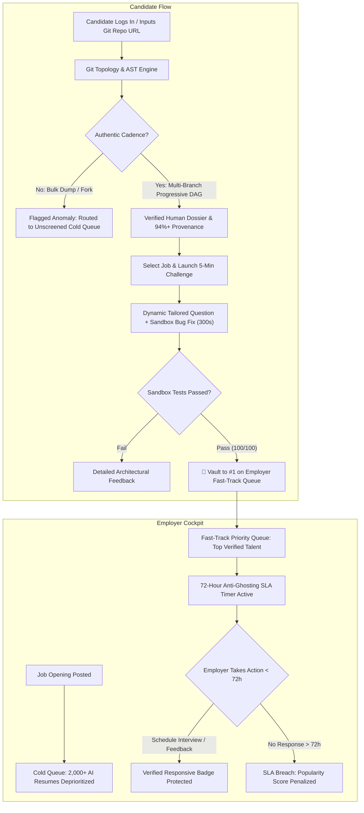

# ⚡ Horizon · Zero-Resume Proof-of-Competence Platform

> **HackShift 2026** · Round 2 @ IIIT Delhi (Esya '26)  
> **Theme**: Entrepreneurship & Employment ("Connecting Talent, Ideas, and Opportunities")  
> **Live Deployed Application**: [https://hackshift-2026.onrender.com/](https://hackshift-2026.onrender.com/)

[](https://hackshift-2026.onrender.com/)
[](https://hackshift-2026.onrender.com/)
[](https://hackshift-2026.onrender.com/)
[](https://hackshift-2026.onrender.com/)

---

## 📌 1. The Problem

In 2024–2026, **Generative AI broke recruitment and technical hiring**:
1. **The AI Resume Flood**: Browser extensions (Simplify, LazyApply) and automated LLM agents blast **2,000+ hallucinated resumes** into every job opening within 48 hours.
2. **The Candidate Black Hole (Ghosting)**: Hiring managers and recruiters cannot review thousands of PDFs. Overwhelmed, they resort to ghosting applicants or configuring arbitrary keyword ATS filters that discard authentic builders.
3. **Broken Traditional Evaluations**: 
   - *LeetCode-style tests* are defeated by secondary monitor LLM extensions.
   - *Take-home projects* demand 8–15 hours of unpaid labor, only to be submitted to an unresponsive black hole.
   - *GitHub profiles are spoofed* with 1-commit synthetic bulk dumps and forked clones claiming false authorship.

**The result**: Top engineers are invisible, companies miss exceptional talent, and hiring cycles drag on for months.

---

## 💡 2. The Solution

**Horizon** eliminates PDF resumes entirely and replaces keyword screening with verifiable engineering provenance and proof-of-work:

1. **Zero PDF Resumes**: No CV uploads, no keyword gaming. Candidates authenticate with their public GitHub handle or repository URL.
2. **Git Commit Topology & AST Cadence Engine**: Horizon inspects the raw Git DAG, commit velocity, branch divergence, and AST code evolution over time. It instantly distinguishes authentic, progressive human development (`feat:`, `fix:`, `refactor:`) from 1-commit AI/fork bulk dumps.
3. **Dynamic 5-Minute Micro-Assessment**:
   - An architectural defense question dynamically tailored to the candidate's **own repository code**.
   - A live, in-browser concurrency bug fix executed inside a sandboxed runtime.
   - Server-enforced **300-second timer** with timestamp verification (resistant to dev-tools tampering).
4. **Fast-Track Queue Vaulting**: Passing the 5-minute micro-assessment vaults the candidate directly to **#1 on the Employer's Fast-Track Priority Queue**, completely bypassing thousands of cold, unverified resumes.
5. **Anti-Ghosting 72-Hour SLA Guarantee**: Employers commit to a mandatory 72-hour turnaround. Timely disposition earns the **"Verified Responsive Employer"** trust badge; ghosting penalizes the employer's public score.

---

## 🏗️ 3. Implementation Details

### System Architecture
Horizon is engineered as a zero-latency, production-ready system:
- **Backend Framework**: Python 3.13 / FastAPI asynchronous runtime with Pydantic v2 schemas and Uvicorn ASGI server.
- **Git Topology Analyzer**: Dual-mode engine that executes shallow local clones (`git clone --depth 35`) and native `git log` / `git rev-list` subprocess inspection, paired with GitHub REST API fallback telemetry for sub-second responses.
- **Code Execution Sandbox**: Isolated Python runtime evaluating AST syntax trees and concurrency primitives (`asyncio.Lock`, shared state race conditions) under strict timeouts.
- **Frontend Architecture**: Modern responsive workspace built with Tailwind CSS, Lucide SVG vector iconography, and vanilla ES6+ reactive modules. Zero Node.js build overhead ensures instant page loads and zero hydration lag.
- **Cross-Tab Synchronization**: Native `BroadcastChannel` protocol syncing candidate actions and employer review dispositions across browser tabs with zero server polling delay.
- **Database & Auth Layer**: Supabase-ready PostgreSQL schema with pre-seeded hiring teams and verified developer personas.

---

## 📊 4. System Flowchart



---

## 🖥️ 5. Interface Wireframe

```
┌───────────────────────────────────────────────────────────────────────────────────────┐
│  ⚡ HORIZON                  [ Challenger Candidate ]   [ Employer Cockpit ]   [Logout] │
├───────────────────────────────────────────────────────────────────────────────────────┤
│                                                                                       │
│   CANDIDATE WORKBENCH                          EMPLOYER COCKPIT (Acme Systems)        │
│  ┌────────────────────────────────────────┐   ┌─────────────────────────────────────┐ │
│  │ Audit Target: github.com/user/project  │   │ Senior Backend Engineer (FastAPI)   │ │
│  │ [ Clone & Verify AST Provenance ]      │   │ 72h SLA: 68h 14m remaining [Active] │ │
│  ├────────────────────────────────────────┤   ├─────────────────────────────────────┤ │
│  │ Authenticity: 94.5% (Verified Human)   │   │ ⚡ FAST-TRACK QUEUE (Verified)      │ │
│  │ DAG: 3 Branches · 4 Merges · Iterative │   │ 1. Aarav Sharma (97.8% Composite)   │ │
│  │                                        │   │    [Schedule Interview] [Review]    │ │
│  │ [=== Interactive Git DAG Canvas ===]   │   ├─────────────────────────────────────┤ │
│  │  (main) ──●─────────●────●             │   │ 📦 COLD RESUME QUEUE (Bypassed)     │ │
│  │  (feat)   └──●───●──┘                  │   │ 2,140 Unscreened PDF Resumes        │ │
│  │                                        │   └─────────────────────────────────────┘ │
│  │ [ Solve 5-Min Tailored Micro-Challenge]│                                           │
│  │   • Self-repo architecture defense     │                                           │
│  │   • TokenBucket concurrency bug fix    │                                           │
│  │   • [Run Code in Sandbox] (300s timer) │                                           │
│  └────────────────────────────────────────┘                                           │
│                                                                                       │
│  Horizon © 2026 · Autonomous AST Provenance Engine · Zero-Resume Standard              │
└───────────────────────────────────────────────────────────────────────────────────────┘
```

---

## 🚀 6. Live Deployment & Quickstart

### Live Production Deployment
* **Live Application URL**: [https://hackshift-2026.onrender.com/](https://hackshift-2026.onrender.com/)

### Run Locally in 60 Seconds
```bash
# 1. Clone repository
git clone https://github.com/DynamicLinker/Hackshift-2026.git
cd Hackshift-2026

# 2. Create and activate virtual environment
python3 -m venv .venv
source .venv/bin/activate

# 3. Install dependencies
pip install -r requirements.txt

# 4. Start Horizon application server
python run.py
```
Open your browser at **`http://localhost:8000`**.

### Run Test Suite & Demo Verification
```bash
# Run 46 automated unit and integration tests
pytest tests/

# Execute the 7-step live stage verification script
python scripts/verify_demo.py
```

---

## 🏆 7. Hackathon Stage Demo Walkthrough (Two-Tab Setup)

1. **Tab 1 (Employer)**: Open `https://hackshift-2026.onrender.com/?role=employer`. Show the Acme Systems opening overwhelmed with **2,140 cold resumes**.
2. **Tab 2 (Candidate)**: Open `https://hackshift-2026.onrender.com/?role=candidate`.
   - Audit `@iiitd-dev`: Show the visual **Git Topology DAG Tree** proving authentic multi-branch iterative human cadence.
   - Contrast with `@ai-spammer`: Show the flatline 1-commit bulk dump anomaly flagged with 21% provenance.
3. **Take Challenge**: Click **"Solve 5-Min Challenge"**. Show the dynamically generated question on Aarav's own `delhi-transit-stream` repo, solve the concurrency bug in the sandbox, and pass (100/100).
4. **The Vault & SLA**: Return to Tab 1. Watch Aarav appear at **#1 on the Fast-Track Queue**. Click **"Schedule Interview"** with 1 click, fulfilling the 72-hour anti-ghosting SLA.
